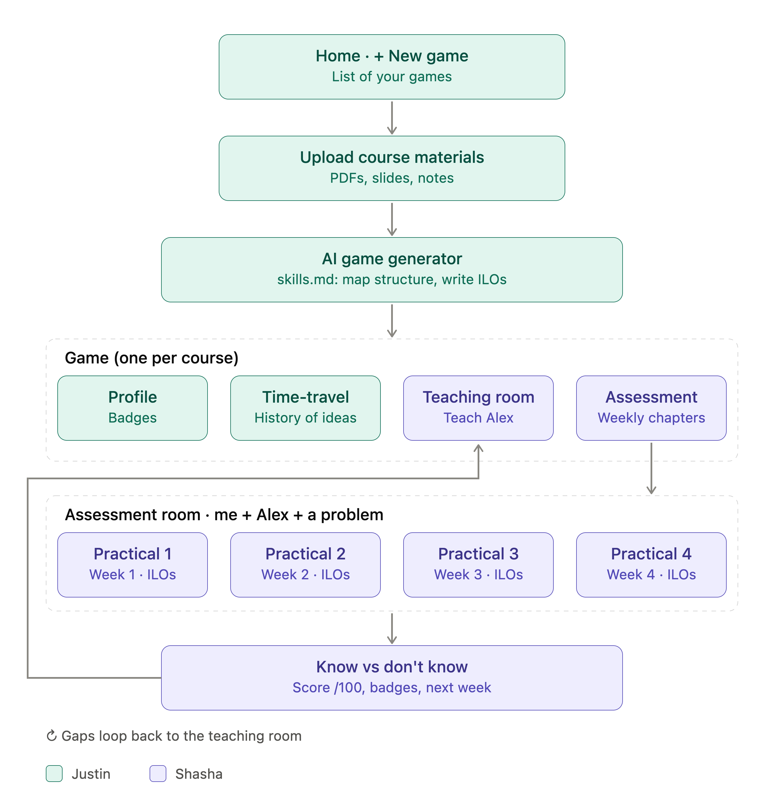
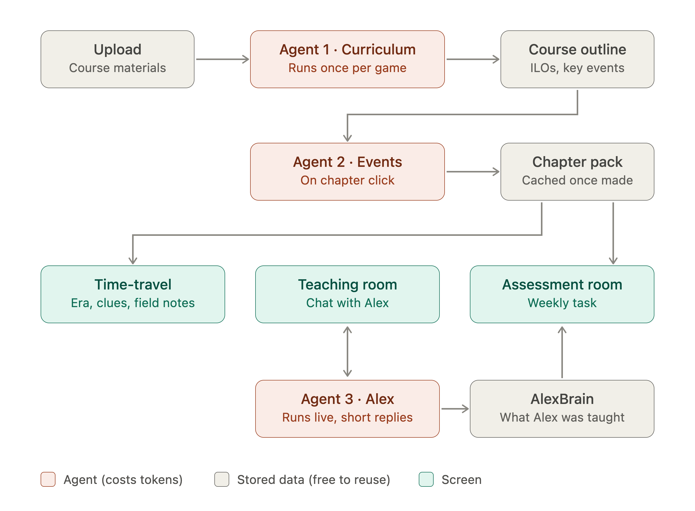

# Teach Alex (working title)

> Teach Alex through history's real engineering problems. If you get it wrong, you change the future.

Built for **Reply Student Tech Clash 2026 · AI on Campus UK** (Direction: Learning).

---

## 1. The idea

Students often learn engineering rules (e.g. "always add a ground plane") without knowing *why* they exist. Labs turn into cookbook exercises and the understanding doesn't stick.

This app turns a course into a game:

1. **Discover**: the student learns a concept by investigating a real historical problem.
2. **Teach**: the student explains it to **Alex**, an AI apprentice who only knows what he is taught.
3. **Test**: the student, Alex and a problem meet in the assessment room.
4. **Reflect**: when Alex fails, the student finds the gap in their own understanding.

Example course used for the prototype: **PCB design**.

---

## 2. App structure



```
Home
 └── [+] New game
      └── Upload course materials (PDF, slides, notes)
           └── Generates a game with 4 sections:
                ├── Profile          → badges, stars, progress
                ├── Time-travel      → the timeline of eras / chapters
                ├── Teaching room    → teach the content to Alex
                └── Assessment room  → weekly interactive task: me + Alex + a problem
```

### 2.1 Home, upload + AI game generator (owner: **Justin**)
- Lists all games the user has created.
- `+` button opens the "New game" flow (upload materials → generate game).
- AI game generator (`skills.md`): maps the course structure into chapters and writes ILOs for each week.

### 2.2 Profile (owner: **Justin**)
- Badges, stars per chapter, overall progress.
- Alex's brain map (what Alex currently knows / misunderstands). *(stretch)*

### 2.3 Time-travel (owner: **Justin**)
- The course as a timeline of historical eras; each era is a chapter with one learning outcome.
- Example (PCB): 1930s wiring nightmare → 1940s built to survive → 1960s–80s density → today signal integrity.
- Handles: chapter generation from course materials, the era's mentor character, knowledge debt across eras.
- *Details to be defined.*

### 2.4 Teaching room (owner: **Shasha**)
- Student explains the concept to Alex by chat (and sketching, stretch).
- Alex asks naive questions, interrupts on jargon, and builds his "brain" only from what he is taught.
- Alex teaches it back at the end, including the student's mistakes.

### 2.5 Assessment room (owner: **Shasha**)
- Weekly interactive task: the student and Alex solve a problem together.
- Alex applies only what he was taught; misconceptions show up as failures.
- Candidate mechanics: predict-the-failure, mission control (pause / limited hints), curveball constraint, sabotage heist, Alex's planted false statement, short oral defence.
- Grading: stars tied to understanding (works / caught mistakes early / defended the design).

### 2.6 AI agents and data flow



Three agents call Claude. Everything they produce is stored and reused, so tokens are only spent when something new is needed.

| Agent | When it runs | Produces | Used by | Status |
|---|---|---|---|---|
| **1 · Curriculum** | Once per game, on upload | Course outline: chapters, ILOs, key events | Agent 2, every screen | Built (`features/new-game/`) |
| **2 · Events** | When a chapter is opened, then cached | Chapter pack: era, clues, field notes, weekly task material | Time-travel, Assessment room | To do |
| **3 · Alex** | Live in the teaching room, short replies | Chat replies + updates to `AlexBrain` | Teaching room (chat), Assessment room (reads `AlexBrain`) | To do |

- **Stored data** (course outline, chapter packs, `AlexBrain`) is free to reuse. Load it before calling an agent again.
- `AlexBrain` is the contract between the teaching room and the assessment room (see section 3).

---

## 3. Shared concepts (agree on these first)

| Concept | Description |
|---|---|
| `Game` | One uploaded course. Contains chapters. |
| `Chapter` | One era + one learning outcome + source material references. |
| `AlexBrain` | Structured record of what Alex was taught (concepts, confidence, misconceptions). Shared by teaching and assessment rooms. |
| `Attempt` | One assessment run: result, stars, mistakes found, hints used. |
| `Badge` | Earned achievements shown on the profile. |

> `AlexBrain` is the contract between the teaching room and the assessment room. Agree its shape before building either.

---

## 4. Suggested tech stack (proposal, open to change)

- **Frontend:** Next.js + TypeScript + Tailwind
- **Backend:** API routes or a small Python (FastAPI) service
- **LLM:** any chat model API with streaming
- **Storage:** SQLite (or JSON files) for games, chapters, Alex's brain and attempts
- **File parsing:** PDF / slides text extraction for uploaded course materials

---

## 5. Repo structure

```
/
├── README.md
├── docs/                         # diagrams and design notes
├── prompts/                      # versioned system prompts, one folder per agent
│   └── game-generator/skills.md  # (later: alex/, mentor/, validator/)
└── apps/web/                     # Next.js app
    ├── data/games/               # generated games as JSON (gitignored)
    └── src/
        ├── app/                  # routes only: thin pages that load data
        │   ├── page.tsx                  # Home
        │   ├── new/                      # New game (upload)
        │   ├── api/games/                # POST: generate a game
        │   └── games/[id]/
        │       ├── layout.tsx            # game title + section tabs
        │       ├── page.tsx              # hub: the 4 sections
        │       ├── profile/
        │       ├── time-travel/
        │       ├── teaching-room/
        │       └── assessment-room/
        ├── features/             # one folder per section: UI, logic, Claude calls
        │   ├── new-game/         # Justin: ingest + generator
        │   ├── profile/          # Justin
        │   ├── time-travel/      # Justin
        │   ├── teaching-room/    # Shasha
        │   └── assessment-room/  # Shasha
        ├── components/           # UI shared across sections
        └── lib/                  # shared types, storage, section list
```

See `apps/web/src/features/README.md` for how a section is wired and where to put new code.

---

## 6. Ownership

| Area | Owner |
|---|---|
| Home, upload flow, AI game generator | Justin |
| Profile (badges) | Justin |
| Time-travel | Justin |
| Teaching room | Shasha |
| Assessment room (weekly practicals) | Shasha |
| Results: know vs don't know (score /100, badges, next week) | Shasha |
| Shared data model (`AlexBrain` etc.) | Both |

---

## 7. MVP scope (Level 2 prototype)

Build **one chapter end to end** before anything else:

- [ ] Upload a PCB course PDF → generate one chapter (1930s wiring nightmare)
- [ ] Teaching room: teach Alex, Alex remembers across turns
- [ ] Assessment room: one interactive task where Alex's mistake comes from the student's teaching
- [ ] Guardrails in code: mentor and Alex never give away the answer
- [ ] Profile shows stars / one badge

---

## 8. Roadmap vs. challenge levels

- **Level 1 · Design:** problem, target user (2nd-year electronics students), scenario, success metrics.
- **Level 2 · Build:** the MVP above.
- **Level 3 · Bonus:** multi-agent setup (mentor, Alex, validator, curriculum, history fact-checker, supervisor), lecturer approval + dashboard (human in the loop), evaluation logs.

---

## 9. Open questions

- What exactly happens in the time-travel section vs. the assessment room?
- How is the weekly assessment task chosen from the materials?
- Sketch input: freeform drawing or drag-and-drop circuit canvas?
- Which LLM provider and how do we store API keys?

---

## 10. Getting started

The web app lives in `apps/web` (Next.js 16 + TypeScript + Tailwind). It calls Claude (`claude-opus-5-5`) through the Anthropic SDK.

```bash
cd apps/web
npm install
cp .env.example .env.local   # then paste your ANTHROPIC_API_KEY
npm run dev                  # http://localhost:3000
```

What's built so far (Justin):

| Part | Where |
|---|---|
| Home: list of games + "New game" | `apps/web/src/app/page.tsx` |
| Upload course materials (PDF, .pptx, .txt/.md) | `apps/web/src/app/new/page.tsx`, `apps/web/src/features/new-game/ingest.ts` |
| AI game generator: maps the course into chapters + writes ILOs | `apps/web/src/app/api/games/route.ts`, `apps/web/src/features/new-game/` |
| Generator instructions (`skills.md`) | `prompts/game-generator/skills.md` |
| Game / Chapter / ILO schema | `apps/web/src/lib/game-schema.ts` |
| Pixel-art UI: save-file Home, the forge (upload), loading/reveal screens | `apps/web/src/components/pixel/`, `apps/web/src/app/new/` |
| Game lobby: pixel room with Profile, Time-travel, Teaching room, Assessment room (sections are placeholders for now) | `apps/web/src/features/lobby/`, `apps/web/src/app/games/[id]/`, `apps/web/src/features/<section>/` |

Generated games are saved as JSON in `apps/web/data/games/`, which is gitignored.

---

## 11. Design system (pixel art)

Every screen uses the same 2D pixel-art style as the lobby. Reuse the pieces below so the teaching and assessment rooms match Home, the forge and the lobby. Styles live in `apps/web/src/app/globals.css`; components in `apps/web/src/components/pixel/`.

### Rules

- **4px grid.** Sizes and offsets are multiples of 4px. Pixel art is SVG with `shapeRendering="crispEdges"` and only `<rect>`s (no curves or gradients).
- **Borders:** add the `px-frame` class for the chunky notched border. Recolour it with `[--px-b:var(--px-gold)]`.
- **Animation:** stepped, sprite-like (`steps(...)`), never smooth easing. Use the ready-made classes, which already switch off for users who prefer reduced motion.
- **Dark room:** the page background is the purple wall. Panels sit on top in ink (dark) or cream (speech/labels).

### Colours

Use them as Tailwind classes, e.g. `bg-px-ink`, `text-px-gold`, `[--px-b:var(--px-mint)]`.

| Token | Hex | Use |
|---|---|---|
| `px-wall` | `#2a2140` | Page background |
| `px-ink` | `#1a1428` | Panels, borders, dark text on cream |
| `px-night` | `#120e1e` | Inputs, logs, HUD bars |
| `px-cream` | `#f3ebdd` | Main text, speech bubbles, labels |
| `px-muted` | `#a79fbf` | Secondary text |
| `px-gold` | `#f2c14e` | Page titles, stars, focus ring |
| `px-copper` | `#c7773a` | Primary buttons, hover |
| `px-mint` | `#4fbf8e` | Success, progress. **Justin's sections** (Profile, Time-travel) |
| `px-violet` | `#a89cf5` | **Shasha's sections** (Teaching room, Assessment room) |
| `px-red` | `#e0604a` | Errors, the boss door |
| `px-steel` / `px-wood` | `#6e7382` / `#6b4630` | Machines, furniture, shelves |

### Fonts

| Class | Font | Use |
|---|---|---|
| `font-pixel` | Press Start 2P | Titles, buttons, labels. Keep it small: `text-[0.6rem]` to `text-2xl` |
| (default) | VT323 | All body text. Base size is `text-xl` |

### Components

| Component | What it is |
|---|---|
| `PixelButton` | Copper button (`variant="ghost"` for secondary, `size="lg"`, `href` makes it a link) |
| `PixelPanel` | Framed box: `tone="dark" \| "cream" \| "danger"` |
| `SpeechBubble` | Cream bubble for Alex talking |
| `AlexSprite` | Alex: `mood="idle" \| "reading" \| "worried"` |
| `StatusLog` | Terminal-style lines that appear one by one |
| `PixelStar` | Pixel star (the pixel font has no ★) |
| `Machine`, `Cartridge` | The forge machine and game cartridge (Home / New game) |

### Animation classes

`anim-bob` (idle bounce), `anim-glow` (pulse), `anim-blink`, `anim-spin` / `anim-spin-rev` (gears), `anim-pop` (pop in), `anim-puff` (smoke), `anim-flip` (book page), `lift` (hover lift, used with `group-hover:-translate-y-1`).

### Starter for a room

```tsx
import { AlexSprite } from "@/components/pixel/AlexSprite";
import { PixelButton } from "@/components/pixel/PixelButton";
import { PixelPanel, SpeechBubble } from "@/components/pixel/PixelPanel";
import type { Game } from "@/lib/game-schema";

export function TeachingRoomSection({ game }: { game: Game }) {
  return (
    <div className="space-y-6">
      <h2 className="font-pixel text-lg text-px-violet">Teaching room</h2>
      <div className="flex items-center gap-6">
        <AlexSprite className="h-20 w-auto" />
        <SpeechBubble>What's a ground plane?</SpeechBubble>
      </div>
      <PixelPanel className="space-y-4">
        <input className="px-input px-frame" placeholder="Explain it to Alex…" />
        <PixelButton>Teach</PixelButton>
      </PixelPanel>
    </div>
  );
}
```
