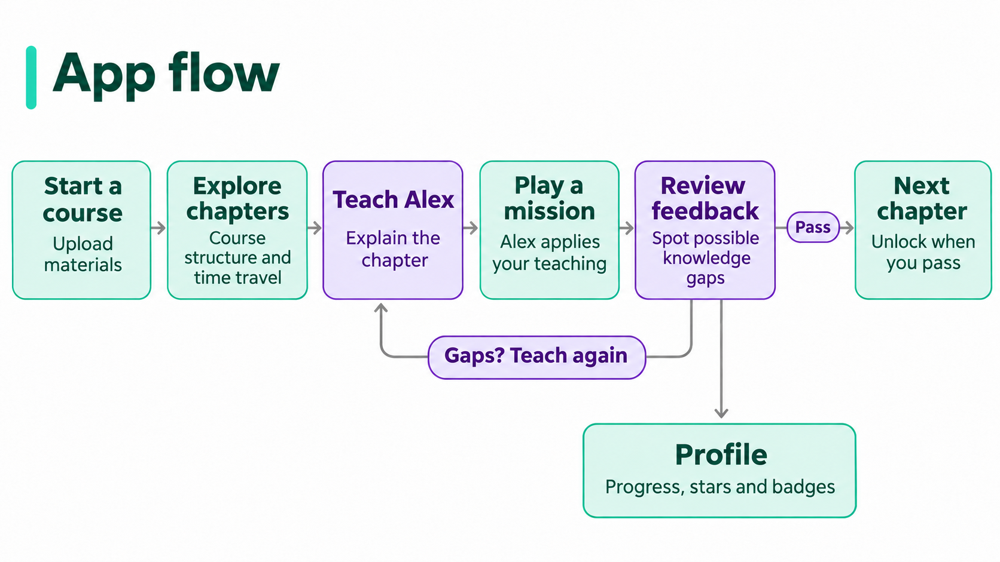
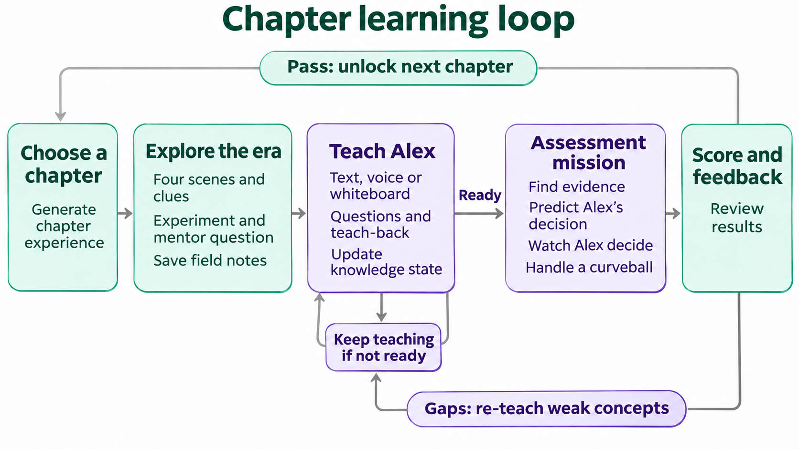
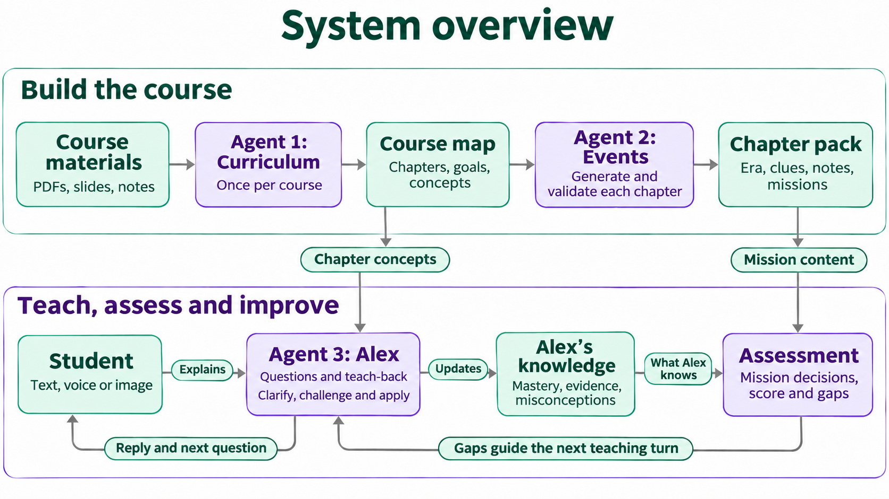

# Flowcharts

Three landscape diagrams using the same visual style: pale mint and lavender boxes, dark text, rounded corners and thin arrows on a white background.

These diagrams summarise the product flow and architecture. They do not replace the implementation contracts or feature status documented elsewhere in the repository.

## App flow

Start a course, explore chapters, teach Alex, play a mission and review feedback. Passing unlocks the next chapter. Gaps lead back to teaching.

## Chapter learning loop

Explore a historical era, explain the chapter to Alex and test his understanding in a mission. Keep teaching when Alex is not ready, and revisit weak concepts after assessment.

## System overview

The curriculum and event agents prepare course and chapter content. Student explanations update Alex's knowledge state, which assessment uses to make mission decisions. Assessment feedback guides later teaching turns.

Validation is grouped with event generation. Assessment, reporting and repair feedback are grouped together for readability.

## Image provenance

The PNGs were redrawn with OpenAI's built-in image generation tool from the team's supplied diagrams and pastel style reference. The prompts requested a 16:9 landscape composition, pale mint and lavender boxes, dark readable text, thin arrows, no HTML tags and preservation of the original flows.

The original diagrams remain at [`../app-flow.png`](../app-flow.png) and [`../agent-architecture.png`](../agent-architecture.png).
